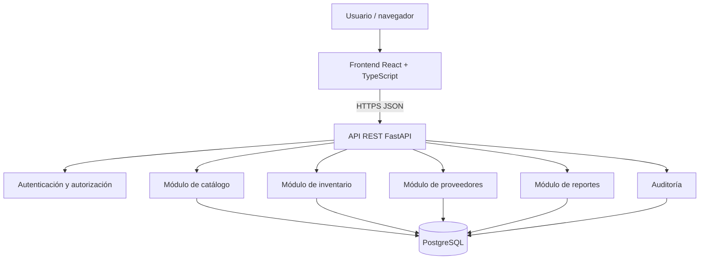

# Fase 2 — Arquitectura del software de ModaStock

- **Versión:** 1.0
- **Estado:** propuesta técnica documentada; pendiente de validación antes de iniciar implementación.
- **Fase:** 2 de 10
- **Base funcional:** requisitos de la Fase 1.

## 1. Propósito

Definir la estructura técnica de ModaStock, sus componentes, responsabilidades, comunicación, límites de seguridad y estrategia de despliegue. La arquitectura debe resolver el MVP de inventario de una tienda de ropa, mantener la trazabilidad de movimientos y permitir evolución sin introducir complejidad operativa innecesaria.

## 2. Requisitos arquitectónicos prioritarios

1. Separar presentación, reglas de negocio y persistencia.
2. Mantener las existencias y su historial consistentes mediante transacciones.
3. Impedir que la interfaz sea la única barrera de autorización.
4. Exponer contratos HTTP/JSON documentados.
5. Facilitar pruebas automatizadas y despliegue reproducible.
6. Evitar dependencias de infraestructura que no exige el MVP.
7. Permitir incorporar más adelante sucursales, integraciones o nuevos canales sin reescribir el núcleo.

## 3. Estilo arquitectónico seleccionado

Se adopta una **arquitectura cliente-servidor de tres capas, con backend monolítico modular y API REST**.

- **Presentación:** aplicación web React + TypeScript.
- **Aplicación y dominio:** API FastAPI en Python, organizada por módulos funcionales.
- **Persistencia:** PostgreSQL, accedida mediante SQLAlchemy y migraciones Alembic.

El monolito modular significa que los módulos se despliegan como una sola aplicación backend, pero mantienen límites internos explícitos. No significa mezclar toda la lógica en un único archivo o módulo.

### 3.1 Alternativas evaluadas

| Alternativa | Ventajas | Costes / riesgos | Decisión |
|---|---|---|---|
| Monolito modular | Menor coste de despliegue, transacciones simples, depuración y pruebas más directas | Requiere disciplina para conservar límites entre módulos | **Seleccionada** |
| Microservicios | Despliegue y escalado independientes por servicio | Añade red interna, observabilidad distribuida, autenticación entre servicios y consistencia distribuida | No justificada para el MVP |
| Aplicación monolítica sin capas | Inicio rápido | Acoplamiento, difícil mantenimiento y pruebas | Rechazada |
| Backend serverless | Escalado administrado y despliegue por funciones | Mayor dependencia del proveedor y complejidad en procesos transaccionales compartidos | No seleccionada para esta etapa |

La decisión podrá revisarse si el volumen, los equipos o las necesidades de disponibilidad justifican servicios desplegables por separado.

## 4. Vista lógica de componentes

### Responsabilidades

| Componente | Responsabilidad | No debe hacer |
|---|---|---|
| Frontend | Navegación, formularios, presentación, validación de experiencia de usuario y consumo de API | Calcular o modificar existencias como fuente de verdad |
| API / controladores | Recibir HTTP, validar esquema, autenticar, autorizar y traducir solicitudes a casos de uso | Contener reglas complejas de negocio |
| Aplicación / casos de uso | Coordinar operaciones y transacciones | Depender de componentes visuales |
| Dominio | Reglas de variantes, stock, movimientos y permisos de negocio | Conocer HTTP o detalles del framework |
| Repositorios | Consultar y persistir entidades | Decidir reglas de negocio |
| PostgreSQL | Persistencia, integridad referencial, restricciones y transacciones | Sustituir validaciones de dominio |

## 5. Módulos del backend

- **Identidad y acceso:** usuarios, roles, permisos, inicio y cierre de sesión.
- **Catálogo:** categorías, productos, referencias, tallas, colores y variantes.
- **Inventario:** existencias, niveles mínimos, entradas, salidas y ajustes.
- **Movimientos:** historial inmutable, motivos, responsables y referencias.
- **Proveedores:** datos básicos y asociación opcional a entradas.
- **Reportes:** consultas agregadas de existencias y movimientos.
- **Auditoría:** eventos administrativos relevantes y registro de errores técnicos sin secretos.

Los módulos pueden compartir una base de datos en el MVP, pero no deben acceder a tablas de otros módulos de forma arbitraria. El acceso debe pasar por servicios o repositorios definidos.

## 6. Flujo crítico: movimiento de inventario

1. El cliente envía una solicitud autenticada para registrar entrada, salida o ajuste.
2. La API valida formato, identidad y permiso.
3. El caso de uso inicia una transacción de base de datos.
4. Se bloquea la fila de la variante o se aplica una estrategia equivalente de concurrencia para evitar salidas simultáneas inconsistentes.
5. Se valida que la cantidad sea positiva y que la salida no supere la existencia disponible.
6. Se actualiza la existencia y se inserta el movimiento con tipo, cantidad, motivo, usuario y fecha.
7. Se confirma la transacción. Si falla cualquiera de los pasos, se revierte todo.
8. La API responde con la existencia resultante y el identificador del movimiento.

La estrategia concreta de bloqueo y concurrencia se verificará en la Fase 4 y mediante pruebas concurrentes en la Fase 9. No se permitirá actualizar existencias desde el navegador ni editar o borrar movimientos confirmados.

## 7. Contrato de comunicación

- Protocolo: HTTP sobre TLS en entornos desplegados.
- Formato: JSON UTF-8.
- Prefijo inicial: `/api/v1`.
- Documentación de contrato: OpenAPI generada por FastAPI.
- Fechas: ISO 8601 en UTC en las respuestas; la interfaz presenta la zona horaria local.
- Errores: estructura uniforme con código, mensaje y detalles de validación no sensibles.
- Paginación: parámetros explícitos `limit` y `offset` en listados.
- La API será la autoridad para validación, permisos y reglas de inventario.

## 8. Seguridad arquitectónica

- Contraseñas con hash mediante Argon2id o una alternativa moderna mantenida y configurada de forma segura.
- Tokens de acceso de vida corta o sesión segura; decisión detallada y pruebas en la Fase 5.
- Si se usan cookies, aplicar HttpOnly, Secure, SameSite y protección CSRF acorde al flujo.
- HTTPS obligatorio fuera del entorno local.
- Autorización en servidor para cada operación protegida.
- Validación de entradas y consultas parametrizadas mediante ORM.
- Secretos únicamente mediante variables de entorno o gestor de secretos; nunca en Git.
- CORS limitado a orígenes conocidos.
- Registro de auditoría sin contraseñas, tokens ni datos sensibles.
- Copias de seguridad y procedimiento de restauración antes de producción.

## 9. Despliegue lógico propuesto

**Desarrollo local:** frontend, API y PostgreSQL como servicios separados; Docker Compose podrá facilitar el entorno reproducible.

**Producción inicial:** frontend estático servido mediante HTTPS, API FastAPI como servicio de aplicación y PostgreSQL administrado o alojado en una instancia protegida. La base de datos no se expondrá directamente a Internet.

No se selecciona todavía un proveedor concreto de nube ni se afirma que exista infraestructura desplegada. La elección dependerá de presupuesto, disponibilidad regional, facilidad de operación y política de respaldos.

## 10. Calidad y observabilidad

- Pruebas unitarias del dominio y casos de uso.
- Pruebas de integración con PostgreSQL real o entorno equivalente.
- Pruebas de contrato de API.
- Logs estructurados con correlación de solicitudes.
- Health checks diferenciados para proceso y dependencia de base de datos.
- Métricas y alertas proporcionales al entorno.
- Verificación de migraciones y restauración de respaldos.
- Umbral inicial de rendimiento: el objetivo P95 definido en RNF-05 deberá medirse bajo carga de referencia en Fase 9.

## 11. Límites y evolución

La primera versión asume una tienda y un inventario central. La multi-sucursal no se simula mediante campos improvisados: si se incorpora, requerirá una decisión de dominio y cambios de modelo en Fase 3.

La arquitectura permite añadir módulos o extraer servicios en el futuro, pero no anticipa esa distribución. Integraciones POS, comercio electrónico, aplicación móvil y analítica avanzada quedan fuera del MVP.

## 12. Condiciones de salida de la Fase 2

- [x] Estilo arquitectónico seleccionado y comparado con alternativas.
- [x] Capas y responsabilidades definidas.
- [x] Módulos principales identificados.
- [x] Flujo transaccional crítico descrito.
- [x] Contrato de comunicación inicial definido.
- [x] Seguridad, despliegue y calidad contemplados.
- [ ] Validación de decisiones técnicas y supuestos con el responsable del proyecto.
- [ ] Revisión de coherencia con el diseño de datos de la Fase 3.

## 13. Conclusión

El monolito modular con API REST ofrece el equilibrio más razonable para el MVP de ModaStock: separa responsabilidades, conserva transacciones locales para el inventario y reduce la carga de despliegue frente a microservicios. La arquitectura queda documentada como propuesta técnica; su implementación comenzará en fases posteriores.
