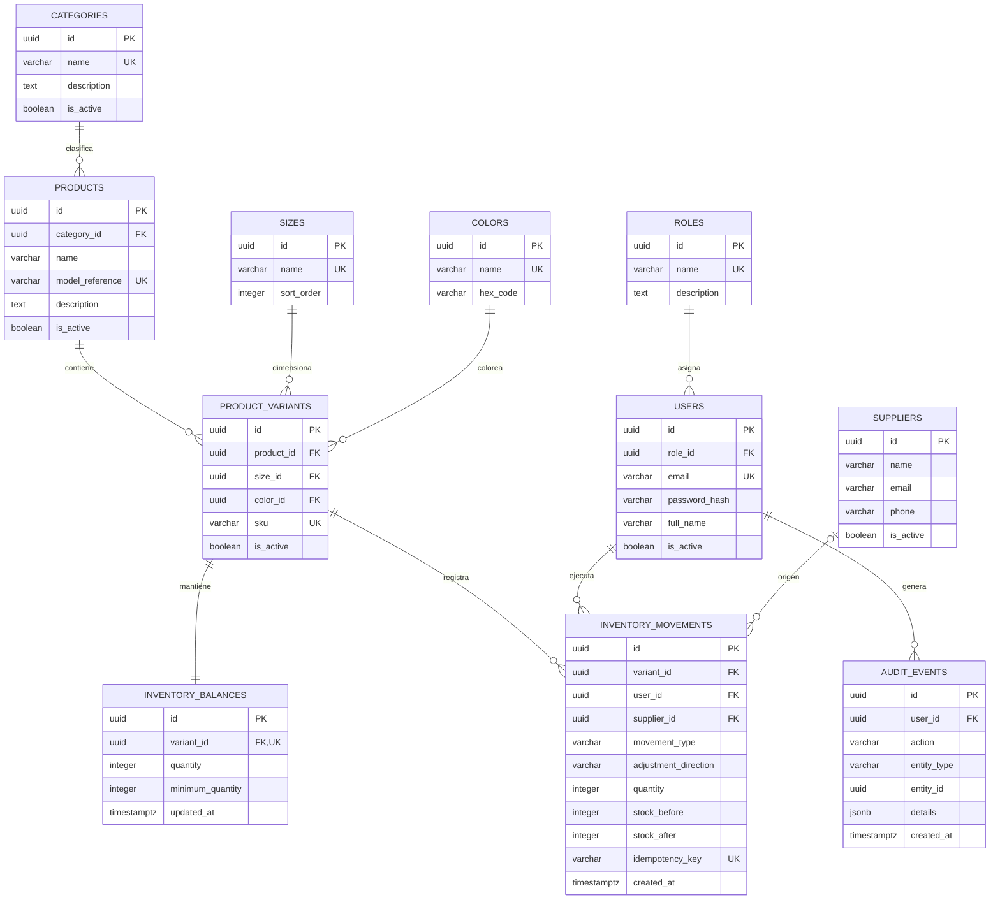

# Fase 3 — Modelo entidad-relación de ModaStock

- **Versión:** 1.0
- **Estado:** diseño lógico propuesto, pendiente de revisión antes de migrar a una base de datos real.
- **Motor objetivo:** PostgreSQL.
- **Alcance:** MVP de una tienda y un inventario central.

## 1. Objetivo

Definir entidades, relaciones y cardinalidades para administrar usuarios, catálogo de prendas, variantes talla-color, existencias, movimientos y proveedores. El diseño debe evitar duplicidad, preservar la trazabilidad y proteger las reglas de inventario.

## 2. Diagrama entidad-relación

## 3. Entidades y propósito

| Entidad | Propósito |
|---|---|
| roles | Agrupar permisos operativos asignables a usuarios |
| users | Identidades individuales que ejecutan acciones |
| categories | Clasificar prendas |
| products | Datos generales del modelo o referencia comercial |
| sizes | Catálogo reutilizable de tallas |
| colors | Catálogo reutilizable de colores |
| product_variants | Combinación concreta de producto, talla y color; unidad de control del stock |
| inventory_balances | Saldo actual y mínimo de cada variante |
| inventory_movements | Libro de movimientos inmutable para entradas, salidas y ajustes |
| suppliers | Proveedores opcionales asociados a entradas |
| audit_events | Registro de acciones administrativas relevantes |

## 4. Relaciones y cardinalidades

- Un rol puede estar asignado a muchos usuarios; cada usuario tiene un rol básico.
- Una categoría puede clasificar muchos productos; un producto puede no tener categoría durante un registro inicial, si la regla de interfaz lo permite.
- Un producto contiene una o más variantes.
- Una talla y un color pueden reutilizarse en muchas variantes.
- La combinación `product_id + size_id + color_id` es única.
- Cada variante tiene exactamente un saldo de inventario.
- Una variante puede tener muchos movimientos.
- Cada movimiento pertenece a una variante y al usuario que lo registró.
- Un proveedor puede asociarse a cero o muchos movimientos de entrada; no es obligatorio para ajustes o salidas.
- Un usuario puede generar muchos eventos de auditoría.

## 5. Decisiones de modelado

### Producto frente a variante

El producto representa el diseño o modelo de prenda. La variante representa la unidad comercial concreta diferenciada por talla y color. El inventario se controla exclusivamente por variante, no por el producto agregado.

### Saldo y libro de movimientos

Se mantiene un saldo actual en `inventory_balances` para consultas eficientes y un historial en `inventory_movements` para trazabilidad. Ambos deben actualizarse dentro de la misma transacción. Los movimientos confirmados no se editan ni eliminan. Los saldos pueden reconciliarse a partir del saldo inicial y del libro de movimientos.

### Una ubicación inicial

El MVP asume un inventario central. No se crea una tabla de sucursales o almacenes hasta validar el requisito multiubicación. Si se incorpora, el saldo deberá identificarse por variante y ubicación, y los movimientos deberán indicar origen/destino según el caso.

### Eliminación lógica

Productos, categorías, tallas, colores, proveedores y usuarios con historial relacionado deben desactivarse, no borrarse físicamente. Las claves foráneas de movimientos y auditoría deben impedir la pérdida de trazabilidad.

## 6. Reglas de integridad representadas

1. Correo de usuario normalizado y único.
2. SKU de variante único.
3. Referencia de producto única en el ámbito inicial de una tienda.
4. Una única combinación producto-talla-color.
5. Existencias y stock mínimo nunca negativos.
6. Cantidad de movimiento estrictamente positiva.
7. Para entradas: `stock_after = stock_before + quantity`.
8. Para salidas: `stock_after = stock_before - quantity` y no puede ser negativo.
9. Para ajustes: dirección explícita de aumento o disminución y cantidad positiva.
10. El saldo actualizado y el movimiento se confirman atómicamente.

## 7. Pendientes para validación

- Confirmar si la tienda usa referencias globales o si pueden repetirse entre marcas.
- Confirmar tallas libres y categorías de tallaje (alfanumérico, numérico, único).
- Confirmar si se requiere más de un proveedor por entrada o documentos de compra.
- Validar si se necesita aprobación de ajustes.
- Confirmar multiubicación antes de cerrar el esquema físico.

## 8. Conclusión

El modelo separa los datos generales de la prenda de las variantes que realmente tienen existencias. El saldo facilita consultas y el libro de movimientos conserva evidencia de cada cambio. El diseño prioriza integridad, trazabilidad y una futura ampliación sin añadir complejidad multi-sucursal al MVP.
